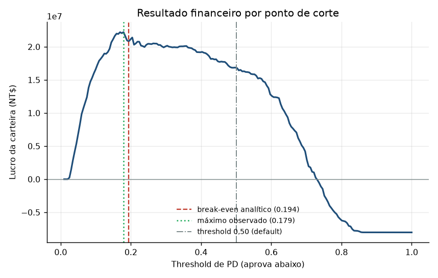
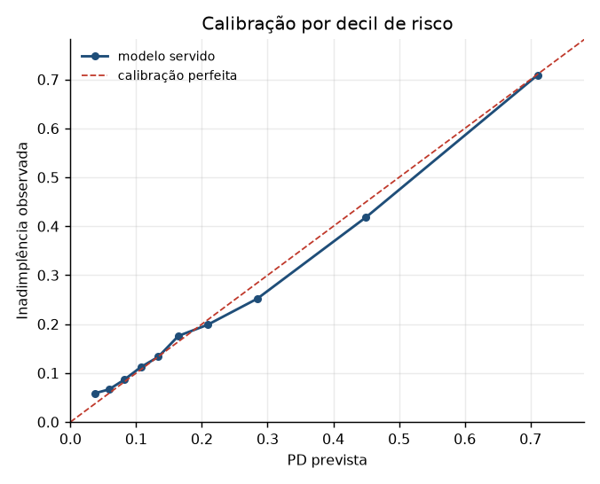
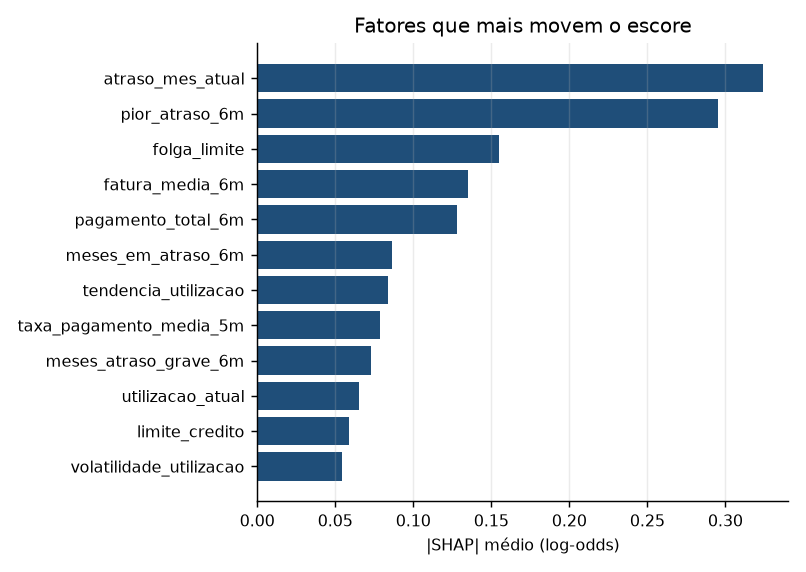

# Motor de Decisão de Crédito

**Trocar o ponto de corte de 0,50 para o break-even econômico rendeu NT$ 4,05 milhões a mais (≈ R$ 728 mil) na carteira de teste — +24,0%, com o mesmo modelo e a mesma AUC.**

A parte difícil de um modelo de crédito não é prever quem vai quebrar. É decidir onde cortar. Este projeto separa as duas coisas: um modelo de PD que estima risco, e uma camada econômica que converte esse risco em decisão de aprovar ou recusar.



---

## O problema

Um classificador entrega probabilidades. Alguém precisa escolher o corte. As escolhas usuais são:

- **0,50**, que vem de graça em qualquer `predict()`;
- **máxima F1** ou **Youden**, que otimizam uma métrica estatística.

Nenhuma delas sabe quanto custa um erro. F1 trata aprovar um mau e recusar um bom como se pesassem igual. Com margem de 18% e LGD de 75%, **um mau aprovado custa mais de quatro bons recusados** — e é essa razão, não a curva ROC, que define onde cortar.

## A solução

Manter a linha de crédito de uma conta vale, em valor esperado:

```
E[manter] = (1 − PD) × Exposição × margem − PD × Exposição × LGD
E[cortar] = 0
```

Igualando as duas e resolvendo para PD, a exposição se cancela:

```
PD* = margem / (margem + LGD) = 0,18 / (0,18 + 0,75) = 19,35%
```

Duas consequências:

1. **O corte ótimo é função exclusiva da economia do produto.** Não depende do modelo, da AUC nem da distribuição de escores. Muda a margem, muda o corte — e o `config.py` é o único arquivo que se toca.
2. **Como a exposição se cancela, um threshold global é ótimo conta a conta.** Não é preciso um corte por faixa de exposição. Isso deixaria de valer se margem ou LGD variassem por segmento, e há um teste travando essa propriedade.

## Resultado

Carteira de teste: 7.500 contas nunca vistas pelo modelo.

| Política | Corte | Aprovação | Inadimpl. da carteira | Lucro | vs corte 0,50 |
|---|---|---|---|---|---|
| Aprovar todos (sem política) | — | 100,0% | 22,12% | **−NT$ 8,03 mi** | — |
| Threshold 0,50 (default) | 0,500 | 87,2% | 15,81% | NT$ 16,86 mi | — |
| Máxima F1 | 0,340 | 79,5% | 13,45% | NT$ 20,00 mi | +18,7% |
| **Break-even econômico** | **0,194** | **62,1%** | **10,88%** | **NT$ 20,90 mi** | **+24,0%** |
| Ótimo empírico (buscado na calibração) | 0,264 | 73,3% | 12,27% | NT$ 20,51 mi | +21,7% |

Três leituras que valem mais que o número principal:

**Sem nenhuma política, a carteira é deficitária.** Com 22% de inadimplência e margem de 18%, a receita dos bons não cobre a perda dos maus: −NT$ 8,03 mi. Por isso o ganho é medido contra o corte de 0,50, e não contra o cenário sem política — comparar com uma base negativa produziria um percentual espetacular e vazio.

**O corte analítico ganhou do corte buscado nos dados.** O break-even, que sai de duas constantes de negócio e não olha nenhuma linha do dataset, rendeu mais que o ótimo procurado por varredura na calibração (0,264). O ótimo empírico pegou ruído da amostra de calibração e não generalizou.

**A máxima F1 chegou perto por acidente.** Ela caiu em 0,340, dentro da região razoável da curva, e por isso deixou só 4,3% na mesa. Não há mecanismo garantindo isso: com outra matriz de custo, F1 cairia em qualquer lugar. O platô a 1% do ótimo vai de 0,169 a 0,179, e nenhuma métrica estatística tem motivo para cair ali.

## O modelo

LightGBM sobre 24 features de comportamento, treinado em 15.300 contas.

| Métrica | Teste |
|---|---|
| AUC | 0,7775 |
| KS | 0,4225 |
| Brier | 0,13485 |
| PD média prevista vs observada | 0,2237 vs 0,2212 |
| Maior desvio por decil | 0,032 |



### A calibração que não foi feita

A conta de lucro multiplica PD por dinheiro. Se a PD estiver enviesada, a curva de lucro é ficção e o "ótimo" é ruído — então calibrar parecia obrigatório.

O pipeline coloca três candidatos para competir num conjunto de seleção separado: escore bruto, isotônico e Platt. **Venceu o escore bruto.**

| Calibrador | Brier (seleção) | PD média | Taxa observada |
|---|---|---|---|
| **bruto** | **0,13393** | 0,2235 | 0,2209 |
| Platt | 0,13411 | 0,2185 | 0,2209 |
| isotônico | 0,13451 | 0,2176 | 0,2209 |

Com `objective="binary"`, sem `scale_pos_weight` e com 22% de eventos, o LightGBM já sai calibrado. Isotônico e Platt só adicionaram variância. A primeira versão deste projeto aplicava isotônico por padrão e **piorava** o Brier de 0,13464 para 0,13513 — a etapa correta era não fazer nada, e isso só apareceu porque a decisão virou uma medição em vez de um hábito.

O conjunto de calibração ainda é dividido em dois: metade ajusta os candidatos, metade escolhe o vencedor. Escolher no mesmo dado do ajuste elegeria sempre o isotônico, que é o mais flexível.

### Partições

Quatro conjuntos, cada um com uma função única:

| Conjunto | Contas | Função |
|---|---|---|
| treino | 15.300 | ajusta as árvores |
| early-stop | 2.700 | define o número de árvores |
| calibração | 4.500 | ajusta e escolhe o calibrador |
| teste | 7.500 | tocado uma vez, no fim |

Separar early-stop de calibração não é preciosismo: se o mesmo conjunto parasse o boosting e ajustasse o calibrador, o calibrador estaria corrigindo um viés que ele próprio ajudou a criar. O threshold empírico e o de F1 também são buscados na calibração e só depois aplicados ao teste — procurar o ótimo no teste e reportar o lucro de lá é escolher e avaliar no mesmo dado.

## Features

As colunas do UCI são cifradas (`PAY_0`, `BILL_AMT3`). Treinar direto nelas dá boa AUC e não diz nada a um analista de crédito. Elas viram grandezas que um comitê reconhece:

- **Utilização de limite** — atual, média, máxima, tendência e volatilidade no semestre
- **Comportamento de pagamento** — percentual da fatura quitado, tendência, meses sem pagamento, meses de quitação integral
- **Severidade e trajetória de atraso** — pior atraso, meses em atraso, meses em atraso grave, piora no semestre
- **Sinal composto** — saldo crescendo enquanto o pagamento cai, o cliente financiando consumo com a linha

Um detalhe de alinhamento que muda o resultado: `PAY_AMT{t}` quita a fatura de `BILL_AMT{t+1}`. Dividir pagamento e fatura do mesmo índice mede a coisa errada.



A EDA está em [`notebooks/01_eda.ipynb`](notebooks/01_eda.ipynb), com outputs executados. Ela responde três perguntas que mudaram o desenho do motor, e uma delas de forma inesperada: a desigualdade de exposição entre os inadimplentes (Gini 0,657) é praticamente idêntica à da base inteira (0,646). Quebrar não é evento de conta grande nem de conta pequena, então nenhuma regra simples de exposição substitui a leitura comportamental — o que casa com a álgebra em que a exposição se cancela.

### Atributos protegidos

`SEX` e `MARRIAGE` existem no dataset e são preditivos. **Estão deliberadamente fora das features.** Usar sexo ou estado civil em decisão de crédito é discriminação vedada — no Brasil pelo CDC art. 39 e pela Res. CMN 4.949, nos EUA pelo ECOA/Reg B. Um ganho de AUC obtido assim não é utilizável.

Eles ficam retidos como eixo de auditoria. Excluir a variável não garante ausência de efeito: outras features podem funcionar como proxy, então a verificação é sobre o resultado.

| Grupo | Contas | Aprovação | Inadimpl. observada | Índice de paridade |
|---|---|---|---|---|
| 26–35 anos | 3.154 | 66,3% | 19,3% | 1,000 |
| 36–45 anos | 2.153 | 63,7% | 22,4% | 0,961 |
| 56+ anos | 224 | 59,8% | 28,6% | 0,902 |
| 46–55 anos | 1.012 | 56,6% | 24,8% | 0,854 |
| **até 25 anos** | 957 | **50,9%** | 26,4% | **0,767** |

Por sexo a paridade fica em 0,951 (feminino 63,3%, masculino 60,2%), com inadimplência observada de 21,2% e 23,5%. Em ambos os eixos a diferença de aprovação acompanha diferença de risco observado, o que a torna defensável — mas o grupo de até 25 anos fica abaixo da regra dos 4/5 usada como referência em fair lending (0,767 < 0,80) e é o ponto que exigiria justificativa formal em um comitê. Relatório completo em [`reports/fairness.csv`](reports/fairness.csv).

## Explicabilidade

Negar crédito sem saber apontar o motivo é problema jurídico antes de ser problema técnico. Cada decisão vem com reason codes:

```
Conta recusada — PD 34,4%
  - severidade do pior atraso nos últimos 6 meses      (+0,457)
  - percentual médio da fatura pago no semestre        (+0,164)
  - margem disponível no limite                        (+0,156)
  - quantidade de meses com atraso no semestre         (+0,086)
```

São valores SHAP **exatos**, não aproximados por amostragem, e sem a dependência do pacote `shap`: o LightGBM expõe o TreeSHAP interno via `predict(pred_contrib=True)`. Uma dependência pesada a menos pelo mesmo resultado.

## Monitoramento

Modelo de crédito não morre de erro de código — morre de mudança de população. O pipeline calcula PSI sobre o escore e CSI por feature, e simula uma safra deteriorada (30% da base passando a atrasar mais e pagar menos) para verificar se o alarme dispara.

**Ele não disparou.** O PSI do escore ficou em 0,027, dentro da faixa "estável" (< 0,10), enquanto a taxa de aprovação caía de 62,1% para 55,1% — 7 pontos percentuais de carteira, sem ninguém tocar no threshold. O CSI por feature pegou: `pior_atraso_6m` em 0,21, `meses_em_atraso_6m` em 0,19.

A conclusão está no código e vale mais que um PSI verde: **PSI agregado sobre o escore é pouco sensível, e monitorar só ele não basta.** Um alarme que nunca foi testado não é evidência de estabilidade — é ausência de teste.

## Rodando

```bash
python -m venv .venv && .venv/Scripts/activate    # Linux/macOS: source .venv/bin/activate
pip install -r requirements.txt
```

Pipeline completo — baixa o dataset, treina, avalia e gera tudo em `reports/`:

```bash
python -m scripts.train
```

Simulador de política:

```bash
streamlit run app/streamlit_app.py
```

Testes da camada econômica:

```bash
python -m pytest tests/ -q
```

## Estrutura

```
src/
  config.py       premissas econômicas e caminhos — o único arquivo a tocar
                  para mudar margem, LGD ou moeda
  data.py         download do UCI e nomes legíveis
  features.py     24 features com semântica de risco
  model.py        LightGBM + seleção medida de calibrador
  decision.py     break-even, curva de lucro, comparação de políticas
  explain.py      reason codes via TreeSHAP do LightGBM
  monitoring.py   PSI, CSI e auditoria de fairness
scripts/train.py  pipeline ponta a ponta
notebooks/        EDA executada
app/              simulador de política e análise de conta
tests/            16 testes da camada econômica
reports/          tabelas e figuras geradas
```

## Escopo e limites

**A decisão modelada é de gestão de conta, não de originação.** O dataset traz 6 meses de histórico de fatura e pagamento de contas já abertas, então a pergunta que ele responde é "manter ou cortar a linha rotativa deste cliente", e não "conceder cartão a este solicitante". Usar o saldo atual como exposição é legítimo nesse enquadramento e seria vazamento no outro.

**A carteira é de crise.** São contas de um emissor de Taiwan em 2005, no meio do estouro do crédito rotativo local, com 22% de inadimplência. Uma carteira brasileira saudável opera bem abaixo disso, e o break-even se desloca junto.

**Margem e LGD são premissas, não medições.** 18% e 75% são plausíveis para cartão rotativo, mas não vêm do dado — vêm do `config.py`, e o app permite mexer nas duas para ver a decisão se mover. O ganho de +24,0% é robusto à faixa razoável desses parâmetros porque a curva de lucro tem um platô largo; o corte específico de 19,35%, não.

**Sem reject inference.** Só há rótulo para contas que permaneceram na carteira. Um motor em produção precisaria tratar o viés de seleção das contas já cortadas.

**Valores em NT$.** A conversão para BRL no README e no app usa uma taxa fixa de referência (R$ 0,18) e serve só para dar escala.

## Dados

[UCI Machine Learning Repository — Default of Credit Card Clients](https://archive.ics.uci.edu/dataset/350/default+of+credit+card+clients). 30.000 contas, 23 atributos, inadimplência de 22,12%. Baixado automaticamente pelo pipeline.
